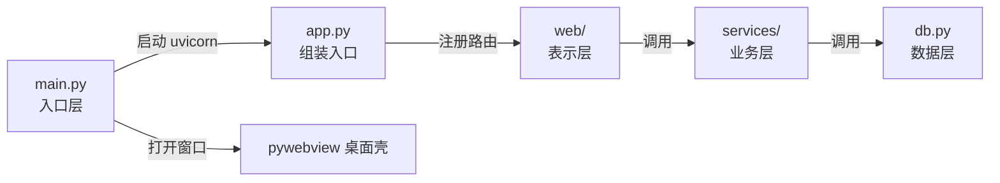

# 项目结构与代码规范

## 标准项目结构（分层模块化）

所有 `fasthtml-desktop` 项目统一采用**分层模块化**结构：表示层（视图与路由）→ 业务层（业务域包）→ 数据层（数据访问）。依赖单向自上而下，禁止跨层调用。参照实现：`examples/FastERP/`（内层 `FastERP/FastERP/`：`web/` 表示层 + `fasterp/` 业务域包 + `db.py` 数据层 + `web_app.py` 组装入口）。

### 分层骨架

```text
my-desktop-app/
├── pyproject.toml            ← 项目配置与依赖声明
├── .venv/                    ← 虚拟环境（不提交）
├── .env.example              ← 环境变量模板
├── .gitignore                ← 忽略规则
├── src/
│   ├── __init__.py
│   ├── main.py               ← ★ 应用入口（pywebview + uvicorn，基本不动）
│   ├── app.py                ← ★ 组装入口：fast_app + 模块注册 + 路由转发（不写业务）
│   ├── web/                  ← 表示层：视图与路由（按页面/功能域拆模块）
│   │   ├── __init__.py
│   │   ├── views.py          ← 页面视图（按 ② 页面结构清单实现）
│   │   ├── layout.py         ← 布局框架与设计系统（统一 CSS 变量 + page() 壳）
│   │   ├── landing.py        ← 落地页 / 登录
│   │   └── ...
│   ├── services/             ← 业务层：业务域包（按业务域拆模块，高内聚低耦合）
│   │   ├── __init__.py
│   │   ├── sales.py          ← 业务域：销售（自含业务规则与状态机）
│   │   ├── purchasing.py     ← 业务域：采购
│   │   ├── inventory.py      ← 业务域：库存
│   │   ├── accounting.py     ← 业务域：会计
│   │   ├── config.py         ← 技术横切：配置
│   │   └── errors.py         ← 技术横切：错误
│   ├── db.py                 ← 数据层：单一数据访问面（Repository 模式）
│   ├── migrations/           ← SQL 版本化迁移（可选）
│   └── pyinstaller_hooks/    ← PyInstaller 元数据钩子
├── data/                     ← 运行时数据（SQLite 数据库等）
│   └── .gitkeep
├── tests/                    ← 测试（对着业务域接口写：test_accounting / test_api / ...）
│   └── __init__.py
└── README.md                 ← 双用途说明（用户说明书 + LLM 克隆说明书）
```

### 模块划分：业务域优先

模块第一维度是**业务域**（sales / purchasing / inventory / accounting / preorders），技术横切（auth / config / errors）为第二维度：

- **表示层 `web/`**：按页面/功能域拆模块（views / layout / landing / seo / api 等），每个模块只渲染自己的页面与交互，只调业务层接口，不直接读写数据库。
- **业务层 `services/`**：按业务域拆包，每个域自含业务规则与状态机；模块间只经显式函数/接口通信，禁止互相 import 内部实现。
- **数据层 `db.py`**：单一数据访问面（Repository 模式），业务层不直接写 SQL。

选择依据：

| 维度 | 分层模块化（默认，全部业务系统） |
|------|----------------|
| 项目复杂度 | 业务系统一律分层；单页脚本不适用本结构 |
| 模块拆分 | ✅ 按业务域拆包，高内聚低耦合 |
| 导入路径 | `from web import views` / `from services.sales import create_order` |
| PyInstaller 配置 | `--collect-submodules fasthtml` + 按需收集业务包 |
| 参照实现 | `examples/FastERP/`（内层 `FastERP/FastERP/`：web/ + fasterp/ + db.py + web_app.py） |

### 核心层分工



#### main.py（入口层）

负责：
- 检测 `sys.frozen` 确定 BASE_DIR
- 启动 uvicorn（`reload=False`）
- 延迟 1.5 秒打开 pywebview 窗口
- 提供优雅退出逻辑

**此文件生成后基本不需要修改。**

#### app.py（组装层）

负责：
- `fast_app()` 初始化（含 LAYOUT_CSS 注入）
- 挂载子应用（如 `/api`）
- 注册各业务域路由（转发到 `web/` 视图函数）

**只做组装，不写业务逻辑。** 参照 FastERP `web_app.py`：纯组装入口，业务全在 `web/` 与业务域包。

#### web/ 表示层（视图与路由）

负责：
- 定义 FastHTML 路由（`@rt`）
- 编写 FastTags 组件与布局（`layout.py` 设计系统）
- 处理表单、HTMX 交互
- 调用业务层接口（禁止直接写 SQL）

**这是界面实现的主工作区**——界面与业务一体，路由函数即界面出口。

#### services/ 业务层（业务域包）

负责：
- 业务规则、用例编排、校验
- 状态机流转（如订单 Draft→Confirmed→Delivered→Invoiced→Closed）
- 只调数据层接口，不依赖 FastHTML UI 细节

**这是业务逻辑的主工作区。**

#### db.py 数据层

负责：
- 单一数据访问面（Repository 模式）
- SQL 与存储适配（SQLite / PostgreSQL 双引擎可选）
- 业务层不直接写 SQL

---

## 代码规范

### 导入顺序

```python
# 1. 标准库
import sys, os, json
from pathlib import Path

# 2. 第三方库
from fasthtml.common import *
import webview
import uvicorn

# 3. 本地模块
from components.layout import sidebar
from utils.helpers import format_date
```

### FastHTML 组件规范

- 位置参数 = 子元素（children）
- 关键字参数 = HTML 属性
- 保留字用下划线别名：`cls` → `class`，`_for` → `for`
- 所有 CSS/JS 必须内联到 `Style()` / `Script()`，不依赖外部文件

```python
# 正确
Div(H1("标题"), P("正文"), cls="container")

# 错误（关键字参数在位置参数前）
Div(cls="container", H1("标题"))
```

### 路径适配（打包安全）

```python
if getattr(sys, 'frozen', False):
    BASE_DIR = Path(sys.executable).parent   # 打包后：exe 所在目录
else:
    BASE_DIR = Path(__file__).parent.parent   # 开发环境：项目根目录

DB_PATH = BASE_DIR / "data" / "app.db"
CONFIG_PATH = BASE_DIR / "config.json"
```

### 日志规范

```python
import logging
from logging.handlers import RotatingFileHandler

LOG_DIR = BASE_DIR / "logs"
LOG_DIR.mkdir(exist_ok=True)

logging.basicConfig(
    level=logging.INFO,
    format="%(asctime)s - %(levelname)s - %(name)s - %(message)s",
    handlers=[
        RotatingFileHandler(LOG_DIR / "app.log", maxBytes=5*1024*1024, backupCount=30),
        logging.StreamHandler(),
    ]
)
logger = logging.getLogger(__name__)
```

### 类型注解

所有函数和方法必须有完整的类型注解：

```python
def process_file(filepath: Path, output_dir: Path) -> dict[str, int]:
    """处理文件并返回统计结果"""
    ...
```

---

## 架构分层与模块化（表示层-业务层-数据层）

所有 `fasthtml-desktop` 项目按 **表示层-业务层-数据层** 三层分层，依赖单向自上而下。这是**模块化、关注点分离、高内聚低耦合**的具体落点：

```
表示层（FastHTML 视图 / HTMX 组件 / 路由）
    │  只调业务层接口，不直接写 SQL / 碰数据库
    ▼
业务层（services/ 业务逻辑 / 用例编排 / 校验）
    │  只调数据层 Repository，不依赖 FastHTML UI 细节
    ▼
数据层（db/ repository / SQLite / 存储）
```

- **模块化**：按业务域拆包（如 `sales`、`purchasing`、`inventory`、`accounting`），技术横切（auth / config / errors）为第二维度，每个模块高内聚、接口清晰；`components/` 放可复用 UI，`utils/` 放无状态工具，`services/` 放业务规则，`db/` 放数据访问。
- **关注点分离**：UI（渲染/交互）、业务规则、数据访问、配置读取、日志各自独立成层/模块，禁止把 SQL 写在视图、把业务规则写在路由、把配置硬编码在组件里。
- **高内聚低耦合**：一个模块只做一件事；模块间经显式函数/接口协作，禁止互相 `import` 内部实现；公共逻辑抽到 `components/`、`utils/` 共享，消除 copy-paste；避免循环依赖。
- **数据访问收敛**：统一走 Repository 模式（见 `references/02-architecture/04-data-architecture.md`），业务层不直接写 SQL，便于替换存储与测试。
- 模块拆分与接口契约流程见 `references/02-architecture/module-design.md`；完整架构设计见 `references/02-architecture/INDEX.md`。

## 约束总结

| 约束 | 原因 | 例外情况 |
|------|------|---------|
| CSS/JS 本地打包 | 打包后 static_path 映射不可靠 | 开发阶段可用 pico=True；打包前必须替换为本地版本 |
| 不用 `serve()` 用 `uvicorn.run(reload=False)` | 冻结后 reload=True 找不到模块 | 开发阶段可用 `reload=True` 加速调试 |
| 路径必须 `sys.frozen` 检测 | 打包后 `__file__` 指向临时目录 | 无例外 |
| 一律 `console=True` | 用户看到启动日志和地址 | 发布版可 `console=False` 隐藏 |
| 日志写入 `BASE_DIR / logs` | 打包后 APPDATA 可写 | 可自定义目录，需确保目录存在 |
| 外部静态文件通过 `--add-data` 打包 | 打包后路径结构变化 | 字体/图片等二进制文件必须用此方式 |
| 不硬编码端口 | 端口可被占用 | 固定端口需异常处理 |

**验证方法**：
| 约束 | 验证命令 |
|------|---------|
| CSS/JS 本地打包 | 检查 `static/` 目录和 `--add-data` 配置 |
| console=True | `grep 'console' *.spec` 确认值 |
| 路径适配 | `grep -r '__file__' src/` 确认都有 `getattr(sys,'frozen')` 保护 |
| 端口固定 | `grep -r 'PORT\|5001' src/` 确认正确 |
